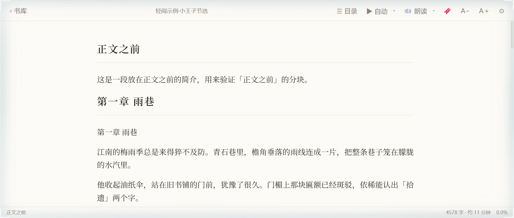
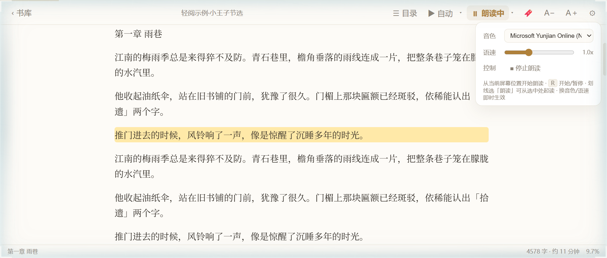
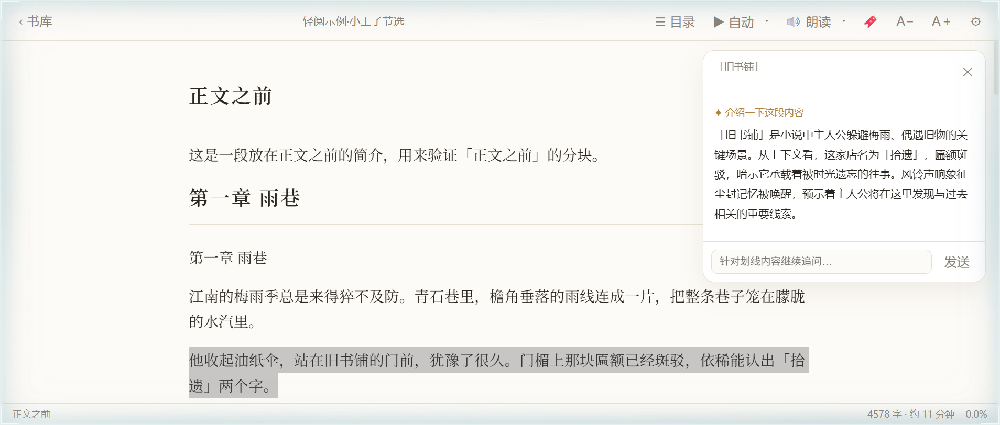
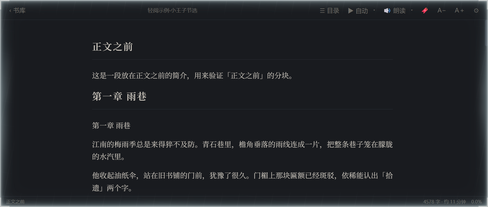

<div align="center">


# 轻阅 · QingYue

**简单 · 高效 · 优雅的 TXT 阅读器**

纯前端、零依赖框架，文件不离开你的设备。


-1f6feb)

**[👉 在线体验（GitHub Pages）](https://xinhang-li.github.io/qingyue-txt-reader/)** —— 无需安装，打开即用。


</div>

## ✨ 特性

**简单**
- 拖入或点选 `.txt` 文件即开始阅读，纯本地运行，不上传任何文件
- UTF-8 / GBK 编码自动识别，老中文小说文件不再乱码

**高效**
- 大文件分章 + 懒加载渲染，滚动时无缝续载，几十万字依然流畅
- 章节智能解析（第X章/回/卷/部/篇、Chapter N、楔子、尾声、番外……），无章节标记时自动分段
- 全文搜索瞬时定位，结果列表 + 正文高亮跳转
- 阅读进度自动保存（IndexedDB），下次打开从上次位置继续；书库保留最近阅读

**优雅**
- 衬线字体排版，四种主题：纸白 / 羊皮纸 / 护眼绿 / 暗夜
- 字号、行距、行宽自由调节，顶部阅读进度条
- 底栏实时显示当前章节、全书字数与预计读完时间

**自动阅读**
- 连续滚动模式：平滑匀速上滚，1–10 档速度（30–520 px/s）
- 整屏翻页模式：每 5–60 秒自动翻一屏
- 空格键开始/暂停，手动滚动即暂停，读到末尾自动停止

**语音朗读**
- 基于 Web Speech API 的听书功能，从当前屏幕位置开始，段落自动高亮并跟随滚动
- 中文音色可选，语速 0.5x–2.0x 可调，长段落自动按标点切分防止引擎卡死
- 朗读中切换音色/语速即时生效，无需暂停；划线选「朗读」可从选中处直接起读

**AI 划线辅助阅读**
- 划线即问：选中人物名 →「介绍」TA 是谁；选中剧情段落 →「概述」情节要点；也支持自由提问与追问
- 划线工具条还带「朗读」：停止先前朗读，直接从选中文本处开始读
- 自动携带划线前后约 700 字上下文，回答更贴合当前情节
- 支持任意 OpenAI 兼容接口（Kimi / DeepSeek / OpenAI 等），Key 仅保存在本机

**书签**
- 顶栏 🔖 或快捷键 `B` 一键收藏当前位置，自动摘录当前段落作为书签摘要
- 侧栏「书签」页签管理：点击跳转回原文位置，支持删除，随书籍持久保存

## 📸 界面一览

| 书库首页 | 阅读界面 |
|---|---|
|  |  |

| 语音朗读（段落高亮跟随） | AI 划线问答 |
|---|---|
|  |  |

| 暗夜主题 | |
|---|---|
|  | |

## 🌸 看板娘「青阅」

轻阅的形象代言人——青阅，一个喜欢在窗边读书的女孩，发间别着和品牌 logo 同款的四叶花。

| 安静阅读 | 开心时刻 |
|---|---|
|  |  |

## ⌨️ 快捷键

| 按键 | 功能 |
|---|---|
| `空格` | 自动阅读 开始/暂停 |
| `R` | 语音朗读 开始/暂停 |
| `B` | 添加书签 |
| `/` | 全文搜索 |
| `←` / `→` | 上一章 / 下一章 |
| `Esc` | 关闭面板 / 返回书库 |

## 🚀 快速开始

**在线版**：直接打开 [https://xinhang-li.github.io/qingyue-txt-reader/](https://xinhang-li.github.io/qingyue-txt-reader/) 即可使用。

**本地部署**：

```bash
npm install
npm run dev
```

然后打开终端中提示的本地地址（默认 `http://localhost:5173`），拖入任意 txt 文件即可。

构建生产版本：

```bash
npm run build   # 输出到 dist/，纯静态文件，可部署到任意静态托管
```

仓库内置了 `sample.txt` 演示文件，可直接拖入体验。

## 🛠 技术栈

- 原生 HTML / CSS / JavaScript（ES Modules），无运行时框架
- [Vite](https://vitejs.dev/) 仅作为开发与构建工具
- IndexedDB 存储书籍内容、阅读进度与书签
- `TextDecoder` 实现 UTF-8 / GBK 编码识别
- Web Speech API（`speechSynthesis`）实现语音朗读
- AI 助手走 OpenAI 兼容的 `chat/completions` 接口，配置仅存 `localStorage`

## 🧪 测试

`tests/` 目录内置 AI 划线功能的联调测试（mock 服务不依赖任何真实 API，模拟 OpenAI 兼容接口的返回）：

```bash
python tests/mock_ai_server.py        # 启动本地 mock AI 服务（8899 端口）
```

然后在 ⚙ 设置中把接口填为 `http://127.0.0.1:8899/v1`、Key 任意，按 `tests/ai-assist-cases.md` 中的 5 个用例逐项验证。

## 📁 项目结构

```
├── index.html      # 页面结构（书库 + 阅读器）
├── public/
│   └── logo.svg    # 四叶花 logo（矢量，favicon + 首页图标）
├── src/
│   ├── main.js     # 全部逻辑：文件读取、章节解析、渲染、搜索、自动阅读、朗读、书签、AI 助手
│   └── style.css   # 主题变量与全部样式
├── docs/assets/    # README 素材：演示 GIF、界面截图、看板娘
├── tests/          # AI 功能 mock 服务与测试用例
└── sample.txt      # 演示文件
```

## 🙌 致谢

本项目由 **Kimi（Moonshot AI）** 开发——从需求讨论、代码实现、调试排错到部署上线，全程由 Kimi 完成；品牌素材（logo 与看板娘形象）由项目所有者提供。

## 📄 License

[MIT](LICENSE)
